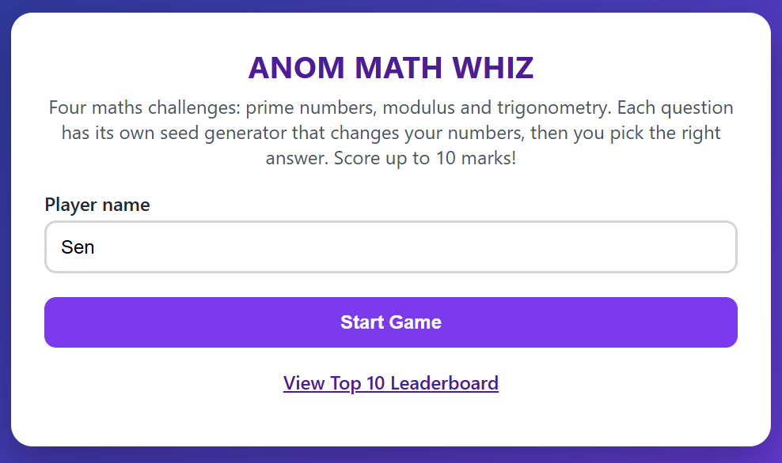
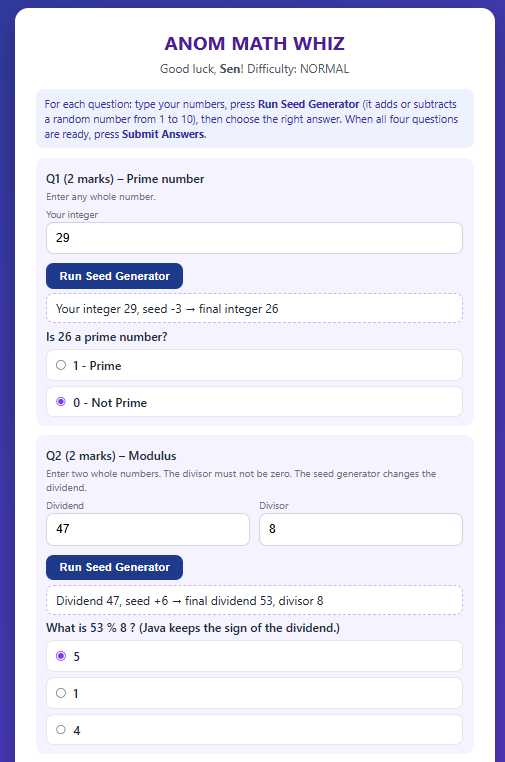
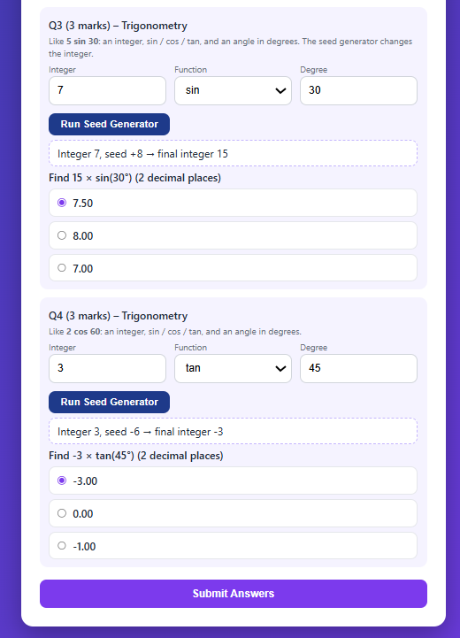
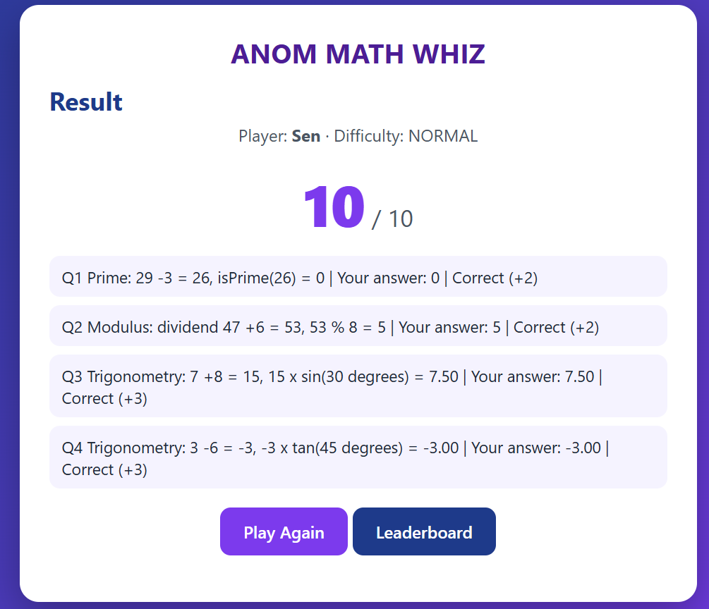
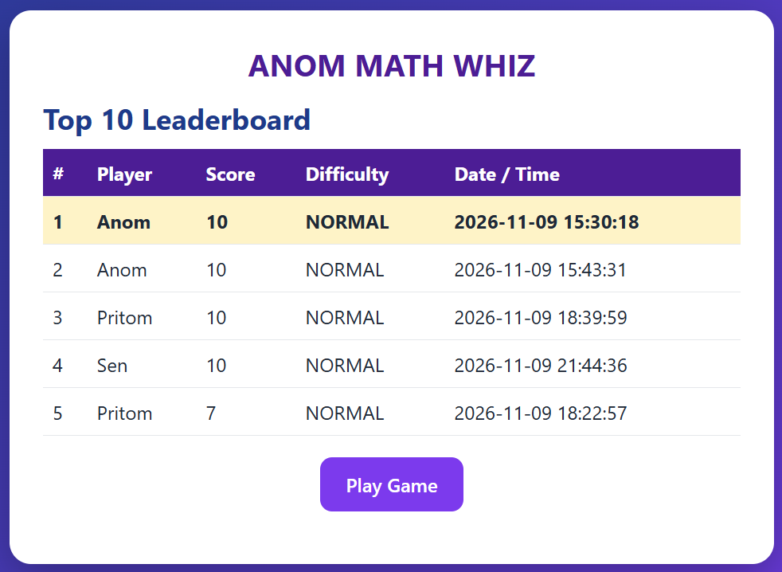

# ANOM – MATH WHIZ

A web-based mathematical game built with **Java Servlets, JSP, JDBC and MySQL**.
The player enters a name, answers four maths questions (one prime number, one modulus, two trigonometry) sees the final score out of **10** and the result is saved to a database. A leaderboard shows the **Top 10** scores.

> **Student:** Pritom Kumar Sen Anom · ICT Department, MBSTU
> 
> **Course:** Software Engineering and Project Management Lab – Lab Practice: Java Servlet & JDBC (10 Marks)

---

## Table of Contents
1. [Project Objectives](#project-objectives)
2. [Technologies Used](#technologies-used)
3. [Software Requirements](#software-requirements)
4. [Database Configuration](#database-configuration)
5. [Steps to Run the Application](#steps-to-run-the-application-intellij-idea)
6. [How to Play](#how-to-play)
7. [Game Rules and Scoring System](#game-rules-and-scoring-system)
8. [Task-wise Implementation (Task 01 – Task 10)](#task-wise-implementation)
9. [Testing and Validation](#testing-and-validation-task-09)
10. [Project Structure](#project-structure)
11. [Application Screenshots](#application-screenshots)
12. [Submission Checklist](#submission-checklist)
13. [GitHub Project Directory Link](#github-project-directory-link)

---

## Project Objectives
- Write reusable Java methods for mathematical calculations.
- Apply conditional logic to evaluate answers and calculate a score.
- Understand Servlet request/response processing (Controller) and JSP views.
- Use JDBC with `PreparedStatement` to INSERT and SELECT records.
- Sort and display database records (Top 10 leaderboard).
- Document and submit the project through GitHub.

## Technologies Used
| Layer | Technology |
|---|---|
| Language | Java 21 |
| Web | Jakarta Servlet 6.0, JSP, JSTL 3.0 |
| Server | Apache Tomcat 10.1 |
| Database | MySQL 8 (`math_whiz_db`) via JDBC (`mysql-connector-j`) |
| Build | Maven (WAR) – see [`pom.xml`](pom.xml) |
| IDE | IntelliJ IDEA |

## Software Requirements
- JDK 21 or newer
- Apache Tomcat **10.1.x** (Tomcat 9 will NOT work: this project uses the `jakarta.*` packages)
- MySQL Server 8 (or XAMPP/MariaDB) and a client (MySQL Workbench or the `mysql` command)
- IntelliJ IDEA with Tomcat support (Maven is bundled)

## Database Configuration
1. Create the database and table by running [`database/math_whiz_db.sql`](database/math_whiz_db.sql).
2. Open [`src/main/resources/db.properties`](src/main/resources/db.properties) and set your MySQL user and password:
   ```properties
   db.url=jdbc:mysql://localhost:3306/math_whiz_db?useSSL=false&allowPublicKeyRetrieval=true&serverTimezone=UTC
   db.user=root
   db.password=your_password_here
   ```
   (Environment variables `DB_URL`, `DB_USER`, `DB_PASSWORD` override this file, so the real password never has to be committed. See [`DBConnection.java`](src/main/java/dao/DBConnection.java).)

### Database Creation SQL
```sql
CREATE DATABASE IF NOT EXISTS math_whiz_db CHARACTER SET utf8mb4 COLLATE utf8mb4_unicode_ci;
USE math_whiz_db;

CREATE TABLE IF NOT EXISTS game_scores (
    id          INT          NOT NULL AUTO_INCREMENT PRIMARY KEY,
    player_name VARCHAR(100) NOT NULL,
    score       INT          NOT NULL,
    difficulty  VARCHAR(20)  NOT NULL DEFAULT 'NORMAL',
    played_at   TIMESTAMP    NOT NULL DEFAULT CURRENT_TIMESTAMP
);
```
Leaderboard query:
```sql
SELECT id, player_name, score, difficulty, played_at FROM game_scores
ORDER BY score DESC, played_at ASC LIMIT 10;
```

## Steps to Run the Application (IntelliJ IDEA)
1. Start MySQL and run [`database/math_whiz_db.sql`](database/math_whiz_db.sql).
2. Edit [`db.properties`](src/main/resources/db.properties) (see above).
3. In IntelliJ: **File → Open →** select `pom.xml` → **Open as Project → Trust Project**. Wait for Maven to download dependencies.
4. **Run → Edit Configurations → + → Tomcat Server → Local.** Choose your Tomcat 10.1 folder.
5. **Deployment** tab → **+ → Artifact → `MathWhiz:war exploded`**. Set **Application context** to `/Anom_MathWhiz`.
6. Click **Run**. Open: <http://localhost:8080/Anom_MathWhiz/>

Without IntelliJ's Tomcat support: run `mvn clean package`, copy `target/Anom_MathWhiz.war` into Tomcat's `webapps/` folder and start Tomcat.

## How to Play
1. Enter your name and press **Start Game**.
2. On the game page every question has its own **Run Seed Generator** button. Type your numbers for that question and press the button.
3. The **seed generator** picks a random number from 1 to 10 and randomly **adds or subtracts** it from your integer. The page then shows the **final integer** and the answer options right inside that question.
4. Choose one option for every question. **Submit Answers** unlocks when all four questions are ready.
5. Java calculates the real answers, gives marks only for correct choices, saves the score to the database and shows the result and the Top 10 leaderboard.

## Game Rules and Scoring System
| Question | Area | Marks | Player enters | Seed generator changes | Player chooses |
|---|---|---|---|---|---|
| Q1 | Prime number | 2 | an integer | the integer (+/- 1 to 10) | `1` (Prime) or `0` (Not Prime) |
| Q2 | Modulus | 2 | dividend and divisor (integers, divisor != 0) | the dividend (+/- 1 to 10) | 1 of 3 remainders |
| Q3 | Trigonometry | 3 | integer, sin/cos/tan, degree (like `5 sin 30`) | the integer (+/- 1 to 10) | 1 of 3 values |
| Q4 | Trigonometry | 3 | integer, sin/cos/tan, degree (like `2 cos 60`) | the integer (+/- 1 to 10) | 1 of 3 values |
| | **Total** | **10** | | | |

- Correct choice = full marks for that question, wrong choice = 0 marks.
- Numbers below 2 are not prime. Q1 and Q2 accept integers only; a zero divisor shows a validation error.
- Java's `%` keeps the sign of the dividend (for example `-7 % 3 = -1`).
- Difficulty is **NORMAL** for every question and is stored in the database.
- Angles are given in **degrees** and converted to radians before using `Math.sin/cos/tan`.
- Trig options are shown with 2 decimal places and compared with a tolerance of **0.01**.
- If the chosen angle makes `tan` undefined (90, 270, ...), the game asks for another angle.
- Correct answers are **calculated by the Java methods when you submit**; they are never stored.

### Core methods ([`service/MathService.java`](src/main/java/service/MathService.java))
```java
public static int    isPrime(int number)
public static int    calculateMod(int a, int b)     // throws IllegalArgumentException if b == 0
public static double calculateSin(double degree)
public static double calculateCos(double degree)
public static double calculateTan(double degree)    // NaN where undefined
```

---

## Task-wise Implementation

> Click any link below to open the exact file / lines in this repository where that task is implemented.

| Task | Topic | Jump to |
|---|---|---|
| [Task 01](#task-01--project-setup) | Project Setup | [`pom.xml`](pom.xml) |
| [Task 02](#task-02--design-the-game-interface) | Game Interface | [`webapp/`](src/main/webapp) |
| [Task 03](#task-03--prime-number-function) | Prime Number Function | [`MathService.java#L21-L33`](src/main/java/service/MathService.java#L21-L33) |
| [Task 04](#task-04--modulus-function) | Modulus Function | [`MathService.java#L35-L42`](src/main/java/service/MathService.java#L35-L42) |
| [Task 05](#task-05--trigonometric-functions) | Trigonometric Functions | [`MathService.java#L44-L60`](src/main/java/service/MathService.java#L44-L60) |
| [Task 06](#task-06--game-logic) | Game Logic and Score | [`MathService.java#L90-L97`](src/main/java/service/MathService.java#L90-L97) |
| [Task 07](#task-07--database-design-using-jdbc) | Database Design using JDBC | [`ScoreDAO.java`](src/main/java/dao/ScoreDAO.java) |
| [Task 08](#task-08--display-top-10-scores) | Top 10 Leaderboard | [`ScoreDAO.java#L33-L49`](src/main/java/dao/ScoreDAO.java#L33-L49) |
| [Task 09](#task-09--testing-and-validation) | Testing and Validation | [`MathServiceTest.java`](src/test/java/service/MathServiceTest.java) |
| [Task 10](#task-10--final-documentation-and-github-submission) | Documentation and GitHub | [`README.md`](README.md) |

---

### TASK 01 – Project Setup
Created a Java Web Application (Maven, WAR packaging) in IntelliJ IDEA, configured for Apache Tomcat 10.1, using Java Servlets + JSP and JDBC (MySQL).

| What | Where in the repository |
|---|---|
| Maven project, dependencies (Servlet API, JSTL, MySQL driver), WAR packaging | [`pom.xml`](pom.xml) |
| Servlet setup (`@WebServlet("/game")`, the controller) | [`GameServlet.java#L31-L70`](src/main/java/controller/GameServlet.java#L31-L70) |
| JDBC connectivity (`DBConnection`) | [`DBConnection.java`](src/main/java/dao/DBConnection.java) |
| Database settings | [`db.properties`](src/main/resources/db.properties) |
| Tomcat configuration steps | [Steps to Run the Application](#steps-to-run-the-application-intellij-idea) |
| Project structure | [Project Structure](#project-structure) |

*Cognitive skill: application architecture and environment configuration.*

---

### TASK 02 – Design the Game Interface
A user-friendly interface with the game title, player name input, Start Game button, four questions with answer inputs, Submit Answers button and a score display section.

| Interface element | Where in the repository |
|---|---|
| Game title (`ANOM – MATH WHIZ`, changed in one place) | [`header.jspf`](src/main/webapp/includes/header.jspf) |
| Player Name input + **Start Game** button | [`index.jsp`](src/main/webapp/index.jsp) |
| Four questions, answer inputs, **Submit Answers** button | [`game.jsp`](src/main/webapp/game.jsp) |
| Per-question **Run Seed Generator** (JavaScript) | [`game.js`](src/main/webapp/js/game.js) |
| Score display section | [`result.jsp`](src/main/webapp/result.jsp) |
| Leaderboard page | [`leaderboard.jsp`](src/main/webapp/leaderboard.jsp) |
| Styling | [`style.css`](src/main/webapp/css/style.css) |
| Form handling (start / seed / submit) | [`GameServlet.java#L41-L86`](src/main/java/controller/GameServlet.java#L41-L86) |

Screenshots: [Welcome Page](#welcome-page) · [Game Page](#game-page---inputs) · [Result Page](#result-page) · [Leaderboard](#leaderboard)

*Cognitive skill: UI design and form handling.*

---

### TASK 03 – Prime Number Function
```java
public static int isPrime(int number)
```
Returns `1` for prime and `0` otherwise. Numbers below 2 are not prime. Only divisors up to √n are tested.

- Implementation: [`MathService.java#L21-L33`](src/main/java/service/MathService.java#L21-L33)
- Tested with different integers (7, 8, 1, 0, -7, 2, 97, 100): [`MathServiceTest.java#L15-L22`](src/test/java/service/MathServiceTest.java#L15-L22)
- Used in the game: [`GameServlet.java#L244-L254`](src/main/java/controller/GameServlet.java#L244-L254)

---

### TASK 04 – Modulus Function
```java
public static int calculateMod(int a, int b)
```
Calculates `a % b`. A zero divisor throws `IllegalArgumentException`, which is shown as a validation error to the player.

- Implementation: [`MathService.java#L35-L42`](src/main/java/service/MathService.java#L35-L42)
- Tested with positive, negative and zero values and the zero divisor: [`MathServiceTest.java#L25-L31`](src/test/java/service/MathServiceTest.java#L25-L31)
- Zero-divisor validation on the game page: [`GameServlet.java#L143-L161`](src/main/java/controller/GameServlet.java#L143-L161)

---

### TASK 05 – Trigonometric Functions
```java
public static double calculateSin(double degree)
public static double calculateCos(double degree)
public static double calculateTan(double degree)
```
Angles are given in degrees, converted with `Math.toRadians()` and calculated using `Math.sin()`, `Math.cos()` and `Math.tan()`. Undefined tangent values (90°, 270°, ...) return `NaN` and the game asks for another angle. Mathematical reference: x² + y² = 1.

- Implementation: [`MathService.java#L44-L60`](src/main/java/service/MathService.java#L44-L60)
- Comparison with a tolerance of 0.01: [`MathService.java#L85-L87`](src/main/java/service/MathService.java#L85-L87)
- Tests (sin 30°, cos 60°, tan 45°, undefined tan, sin²+cos²=1): [`MathServiceTest.java#L34-L41`](src/test/java/service/MathServiceTest.java#L34-L41)
- Trig questions in the game: [`GameServlet.java#L163-L189`](src/main/java/controller/GameServlet.java#L163-L189)

---

### TASK 06 – Game Logic
The four questions (one prime, one modulus, two trigonometric) are generated from the player's numbers plus the seed generator. Answers are evaluated with the Java methods above and the total score is calculated.

```java
int totalScore = 0;
if (primeCorrect) totalScore += 2;
if (modCorrect)   totalScore += 2;
if (trig1Correct) totalScore += 3;
if (trig2Correct) totalScore += 3;      // maximum 10
```

| What | Where in the repository |
|---|---|
| Scoring logic (`calculateScore`) | [`MathService.java#L90-L97`](src/main/java/service/MathService.java#L90-L97) |
| Seed generator and answer options | [`MathService.java#L101-L148`](src/main/java/service/MathService.java#L101-L148) |
| Accept answers, evaluate with the Java methods, calculate total | [`GameServlet.java#L216-L279`](src/main/java/controller/GameServlet.java#L216-L279) |
| Generate the question data (prime, modulus, 2 trig) | [`GameServlet.java#L132-L189`](src/main/java/controller/GameServlet.java#L132-L189) |
| Game state of one round | [`Round.java`](src/main/java/model/Round.java), [`TrigQuestion.java`](src/main/java/model/TrigQuestion.java) |
| Scoring tests (all correct = 10, partial scores) | [`MathServiceTest.java#L54-L59`](src/test/java/service/MathServiceTest.java#L54-L59) |

*Cognitive skill: algorithm integration and conditional logic.*

---

### TASK 07 – Database Design Using JDBC
Database `math_whiz_db` and table `game_scores` (`id`, `player_name`, `score`, `difficulty`, `played_at`).

| What | Where in the repository |
|---|---|
| Database + table creation SQL | [`database/math_whiz_db.sql`](database/math_whiz_db.sql) |
| JDBC connection | [`DBConnection.java`](src/main/java/dao/DBConnection.java) |
| INSERT query (`PreparedStatement`) | [`ScoreDAO.java#L15-L16`](src/main/java/dao/ScoreDAO.java#L15-L16) |
| Save player name, score, difficulty, date/time | [`ScoreDAO.java#L22-L31`](src/main/java/dao/ScoreDAO.java#L22-L31) |
| Retrieve saved records with SELECT | [`ScoreDAO.java#L33-L49`](src/main/java/dao/ScoreDAO.java#L33-L49) |
| Where the score is saved after submission | [`GameServlet.java#L267`](src/main/java/controller/GameServlet.java#L267) |
| Record model (`GameScore`) | [`GameScore.java`](src/main/java/model/GameScore.java) |

---

### TASK 08 – Display Top 10 Scores
The leaderboard shows the ten highest scores sorted by score (descending), with date/time (ascending) as the secondary criterion for equal scores. It shows player name, score, difficulty and date/time.

| What | Where in the repository |
|---|---|
| Top 10 SQL (`ORDER BY score DESC, played_at ASC LIMIT 10`) | [`ScoreDAO.java#L18-L20`](src/main/java/dao/ScoreDAO.java#L18-L20) |
| Retrieve the records | [`ScoreDAO.java#L33-L49`](src/main/java/dao/ScoreDAO.java#L33-L49) |
| Servlet method that loads the leaderboard | [`GameServlet.java#L282-L290`](src/main/java/controller/GameServlet.java#L282-L290) |
| Leaderboard page (table) | [`leaderboard.jsp`](src/main/webapp/leaderboard.jsp) |

Screenshot: [Leaderboard](#leaderboard)

*Cognitive skill: database querying, sorting and data presentation.*

---

### TASK 09 – Testing and Validation
See the full table in [Testing and Validation](#testing-and-validation-task-09). Test code: [`MathServiceTest.java`](src/test/java/service/MathServiceTest.java).

---

### TASK 10 – Final Documentation and GitHub Submission
| Requirement | Where |
|---|---|
| Complete project on GitHub | this repository |
| Complete README.md | [`README.md`](README.md) |
| Database creation SQL | [`database/math_whiz_db.sql`](database/math_whiz_db.sql) and [Database Creation SQL](#database-creation-sql) |
| Project setup instructions | [Steps to Run the Application](#steps-to-run-the-application-intellij-idea) |
| Screenshots | [`screenshots/`](screenshots) and [Application Screenshots](#application-screenshots) |
| Repository subdirectory link | [GitHub Project Directory Link](#github-project-directory-link) |
| Files kept out of Git (`target/`, `.idea/`) | [`.gitignore`](.gitignore) |

---

## Testing and Validation (Task 09)
Run [`src/test/java/service/MathServiceTest.java`](src/test/java/service/MathServiceTest.java) (right-click → Run `MathServiceTest.main()`). It prints PASS/FAIL for every case below.

| Test Case | Expected Result | Test code |
|---|---|---|
| Prime input: 7 | 1 | [L15](src/test/java/service/MathServiceTest.java#L15) |
| Prime input: 8 | 0 | [L16](src/test/java/service/MathServiceTest.java#L16) |
| Prime input: 1 | 0 | [L17](src/test/java/service/MathServiceTest.java#L17) |
| Modulus: 17 % 5 | 2 | [L25](src/test/java/service/MathServiceTest.java#L25) |
| Sine: 30° | 0.5 | [L34](src/test/java/service/MathServiceTest.java#L34) |
| Cosine: 60° | 0.5 | [L35](src/test/java/service/MathServiceTest.java#L35) |
| Tangent: 45° | 1.0 | [L36](src/test/java/service/MathServiceTest.java#L36) |
| Divisor: 0 | Validation error | [L29-L31](src/test/java/service/MathServiceTest.java#L29-L31) |
| All answers correct | Maximum 10 marks | [L54](src/test/java/service/MathServiceTest.java#L54) |
| Incorrect answers | Corresponding marks not awarded | [L55-L59](src/test/java/service/MathServiceTest.java#L55-L59) |

Extra cases also tested: negative numbers and zero for prime and modulus, undefined `tan 90°` / `tan 270°` (NaN), `sin²θ + cos²θ = 1`, angles above 360°, the seed generator range (1 to 10) and the answer options.

## Project Structure
```
MathWhiz/
├── .gitignore
├── pom.xml
├── README.md
├── database/math_whiz_db.sql
├── screenshots/
│   ├── home.png, game.png, options.png, result.png, leaderboard.png
├── src/main/java/
│   ├── controller/GameServlet.java
│   ├── model/GameScore.java, Round.java, TrigQuestion.java
│   ├── service/MathService.java
│   └── dao/ScoreDAO.java, DBConnection.java
├── src/main/resources/db.properties
├── src/main/webapp/
│   ├── index.jsp, game.jsp, result.jsp, leaderboard.jsp
│   ├── js/game.js (per-question Run Seed Generator)
│   ├── includes/header.jspf, footer.jspf
│   └── css/style.css
└── src/test/java/service/MathServiceTest.java
```

## Application Screenshots

### Welcome Page


### Game Page - inputs


### Game Page - after running the seed generator (final integers and options)


### Result Page


### Leaderboard


## Submission Checklist
- [x] Complete Java source code → [`src/main/java`](src/main/java)
- [x] Servlet implementation → [`GameServlet.java`](src/main/java/controller/GameServlet.java)
- [x] JDBC database connectivity → [`DBConnection.java`](src/main/java/dao/DBConnection.java), [`ScoreDAO.java`](src/main/java/dao/ScoreDAO.java)
- [x] Database SQL file → [`database/math_whiz_db.sql`](database/math_whiz_db.sql)
- [x] Four-question mathematical game → [`game.jsp`](src/main/webapp/game.jsp)
- [x] Score calculation (10 marks) → [`MathService.java#L90-L97`](src/main/java/service/MathService.java#L90-L97)
- [x] Top 10 leaderboard → [`ScoreDAO.java#L18-L20`](src/main/java/dao/ScoreDAO.java#L18-L20), [`leaderboard.jsp`](src/main/webapp/leaderboard.jsp)
- [x] Complete README.md → this file
- [x] Application screenshots → [`screenshots/`](screenshots)
- [x] GitHub repository subdirectory URL → [see below](#github-project-directory-link)

## GitHub Project Directory Link
https://github.com/Anom-27/MathWhiz
